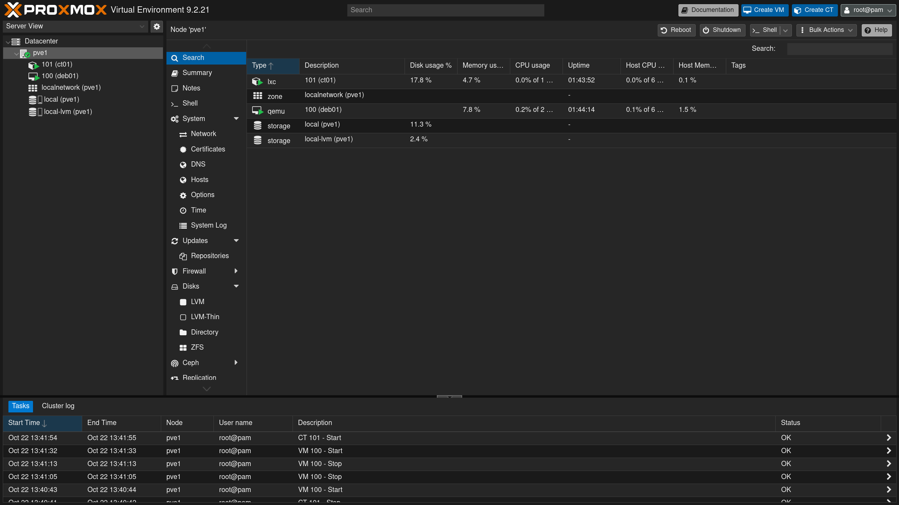
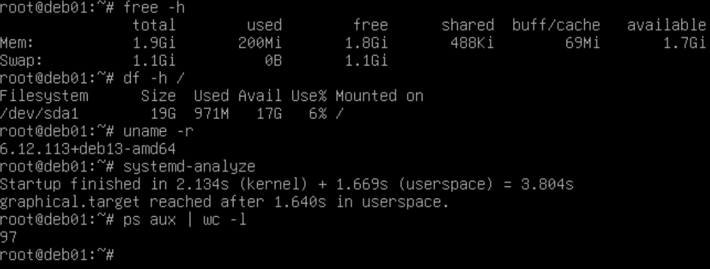
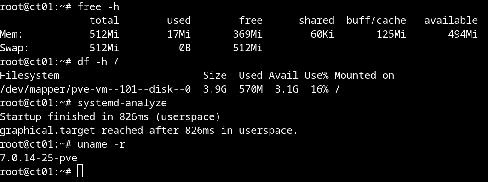
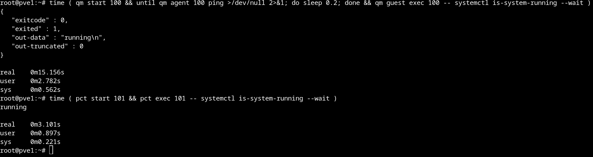

# 01 - Proxmox: a VM and a container, side by side

## Goal

Proxmox lets me manage VMs and containers from one web interface.

In this step I set up a Debian VM and a Debian container inside Proxmox. Then I compare memory use, disk use and startup time.

## Setup

My machine (Fedora):

| | |
|---|---|
| CPU | Ryzen 5 5600 (6 cores, 12 threads) |
| RAM | 32 GB |
| Disk | 512 GB NVMe (mostly free) |

Proxmox runs inside a VM in virt-manager, so my PC stays usable:

| | |
|---|---|
| Hostname | `pve1` |
| CPU | 1 socket, 6 cores, host-passthrough |
| RAM | 20 GB |
| Disk | 200 GB |
| Network | bridge on my home LAN |

## 1. Preparing the host

### CPU

I don't want the Proxmox VM to use an emulated CPU, because it is slower. So:

- CPU virtualization (SVM / AMD-V) must be enabled in the BIOS.
- The CPU of the VM must be set to host-passthrough in virt-manager.

To check that nested virtualization is on:

```bash
cat /sys/module/kvm_amd/parameters/nested
```

It must return `1`.

### Network bridge

I changed the network of the Proxmox VM from NAT (the default) to a bridge. This way the VM shows up on my home network as a normal device, and I can open the Proxmox web interface at `https://<proxmox_ip>:8006`.

I had never set up a bridge. I thought virt-manager would create one for me, but it doesn't. On Fedora I used `nmcli`.

Create the bridge:

```bash
sudo nmcli connection add type bridge ifname bridge0 con-name proxmox-bridge
```

Attach my Ethernet interface (`enp5s0`) to it:

```bash
sudo nmcli connection add type bridge-slave controller bridge0 ifname enp5s0
```

Bring both up:

```bash
sudo nmcli connection up proxmox-bridge
sudo nmcli connection up bridge-slave-enp5s0
```

It took about 30 seconds before `nmcli device status` showed them as connected. The reason is STP (Spanning Tree Protocol, which prevents network loops). It is on by default, so the bridge waits before it forwards traffic. I left it on but i could have turned it off.

## 2. Installing Proxmox

The installer asks for the IP address of the machine. Because the VM is on a bridge, the default is an address from my home router's DHCP. That address could change after a reboot, so it must be static.

There are two main ways to do it:

1. Reserve the address in the router for the VM's MAC address.
2. Shrink the DHCP range and give the machine an address outside of it.

I chose the second one. A free block of addresses lets me add servers later without touching the router each time.

My router's DHCP was giving out the whole subnet (`192.168.1.2` to `192.168.1.254`). I changed the first address to `192.168.1.50`.

Proxmox network settings:

| | |
|---|---|
| IP / CIDR | `192.168.1.10/24` |
| Gateway | `192.168.1.1` |
| DNS | `192.168.1.1` |

Address plan:

| Address | Use |
|---|---|
| `192.168.1.1` | Router |
| `192.168.1.10` | pve1 (Proxmox) |
| `192.168.1.11` | WAN of the firewall VM (planned) |
| `192.168.1.12` | pve2, second node (planned) |
| `192.168.1.50` - `192.168.1.254` | DHCP (router) |

Before installing, I checked that `.10` was free with `arping -D` and `nmap -sn`.



## 3. Debian VM and container

Both use Debian 13. The VM image is a slightly newer point release, which is fine for this comparison.

| | deb01 (VM) | ct01 (container) |
|---|---|---|
| vCPU | 2 | 1 |
| RAM | 2 GB | 512 MB |
| Disk | 20 GB | 4 GB |

Why these values:

- **VM, 2 vCPUs:** with one, the installer and updates feel slow.
- **Container, 1 vCPU:** it only runs a minimal Debian, so one is enough.
- Proxmox itself has only 6 vCPUs and 20 GB of RAM, so I keep every guest small.

**QEMU guest agent (VM only).** It lets Proxmox read the IP address of the VM and shut it down cleanly. I can also run commands inside the VM from the host (`qm guest exec`). A container doesn't need an agent: it shares the host kernel, so Proxmox sees it directly (`pct exec`).

## 4. Results

### Memory and disk

I ran `free -h`, `df -h /`, `uname -r` and `systemd-analyze` in both machines.

| | deb01 (VM) | ct01 (container) |
|---|---|---|
| RAM total (`free`) | 1.9 GiB | 512 MiB |
| RAM used, idle | 200 MiB | 17 MiB |
| Disk size (`df`) | 19 GB | 3.9 GB |
| Disk used | 971 MB | 570 MB |
| Processes (`ps aux`) | 97 | 16 |
| Kernel | `6.12.113+deb13-amd64` | `7.0.14-25-pve` |
| `systemd-analyze` | 3.8 s (2.1 s kernel + 1.7 s userspace) | 0.8 s (userspace only) |





### Startup time

I measured the time from the start command until systemd reports `running`, so both end at the same point.

VM:

```bash
time ( qm start 100 && until qm agent 100 ping >/dev/null 2>&1; do sleep 0.2; done && qm guest exec 100 -- systemctl is-system-running --wait )
```

Container:

```bash
time ( pct start 101 && pct exec 101 -- systemctl is-system-running --wait )
```

| | deb01 (VM) | ct01 (container) |
|---|---|---|
| Time until `running` | 15.2 s | 3.1 s |



### What the numbers show

- **RAM:** the container uses about 12 times less at idle. It has no kernel and no services of its own. `free` inside the container shows the limit I set in Proxmox, and the memory of the host kernel is not counted.
- **Disk:** the container uses about 40% less.
- **Processes:** 16 against 97. The VM count includes kernel threads, while the container only sees its own processes.
- **Kernel:** the container reports a Proxmox kernel (`-pve`), because it shares the one of the host. The VM runs its own Debian kernel.
- **Startup:** the container is ready almost 5 times faster. It has no firmware, no bootloader and no kernel to start. `systemd-analyze` shows no kernel phase for it.
- `systemd-analyze` in the VM only counts the time from when its kernel starts. The rest of the 15 s happens before that or after it (QEMU startup, firmware, bootloader, waiting for the agent).

### VM or container?

- **VM:** when I need a different OS (for example Windows), my own kernel, or stronger isolation.
- **Container:** for light Linux services that need to start fast and use little RAM.

## 5. What I learned

- Setting up a few machines by hand takes time, even if Proxmox makes it easy. I'm already thinking about automation (spoiler: Terraform and Ansible).
- I learned how to set up a bridge to connect a VM to my real network.
- Check what a measurement really measures before trusting it.
- When the network doesn't work, check layer by layer: interface up, then IP, then gateway, then DNS.
