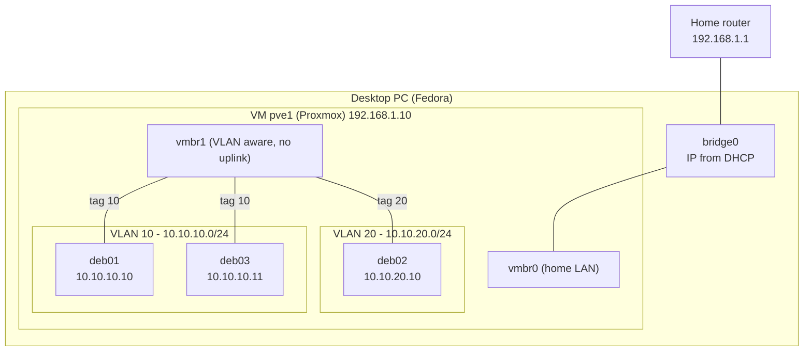

# 02 - Network: bridge and VLANs
 
## Goal
 
Proxmox is configured, so now I want a small network with 3 Debian VMs.
 
- All 3 VMs are attached to the same new Proxmox bridge.
- They are split into 2 logical groups (VLANs).
- They have no access to the Internet or to my home network.
- Only machines in the same VLAN can talk to each other.
The final diagram is in [4. Results](#4-results).
 
## 1. Creating the bridge
 
Proxmox has a default bridge called `vmbr0`. It is attached to the network card of pve1 (`nic0`), which connects to my home network and to the Internet. I don't want the lab VMs on it.
 
So I create a new bridge in the Proxmox interface:
 
`pve1` > `System` > `Network` > `Create` > `Linux Bridge`
 
- **Name:** `vmbr1`
- **VLAN aware:** on. This is important: it lets the bridge forward Ethernet frames to the right VLAN using tags (802.1Q).
- **IPv4/CIDR and gateway:** empty.
- **Bridge ports:** empty.
With no IP and no port, `vmbr1` works as an isolated virtual switch. Then I click **Apply Configuration**, because Proxmox keeps network changes pending until then.
 
## 2. Connecting the VMs to the bridge
 
For each VM:
 
`VM` > `Hardware` > `Network Device` > `Edit`
 
I select `vmbr1` and set a VLAN tag.
 
- deb01: tag `10`
- deb03: tag `10`
- deb02: tag `20`
## 3. Static IPs
 
The VMs are now on the bridge, but they may still use DHCP. That won't work: `vmbr1` has no uplink, so the DHCP server of my router can't reach it. I set the IPs by hand.
 
### Which IPs?
 
RFC 1918 reserves three private address blocks: `10.0.0.0/8`, `172.16.0.0/12` and `192.168.0.0/16`. They are not routed on the public Internet.
 
My home network already uses `192.168.1.0/24`, so I use the `10.0.0.0/8` block for the lab to avoid overlaps. The third number matches the VLAN ID, so I can tell the VLAN from the IP.
 
| VLAN | Network | Gateway | VMs |
|---|---|---|---|
| 10 | `10.10.10.0/24` | `10.10.10.1` (reserved, not used yet) | deb01 `10.10.10.10`, deb03 `10.10.10.11` |
| 20 | `10.10.20.0/24` | `10.10.20.1` (reserved, not used yet) | deb02 `10.10.20.10` |
 
I reserve `.1` in each network for a future gateway.
 
### Setting the IPs
 
Inside the VM I list the network interfaces:
 
```bash
ip link show
```
 
I have the loopback `lo`, which I can ignore, and `ens18`.
 
Then I edit `/etc/network/interfaces`. `man interfaces` was very useful to understand the file.
 
Example for deb01:
 
```
# The primary network interface
auto ens18
iface ens18 inet static
    address 10.10.10.10/24
```
 
- `auto ens18`: bring the interface up at boot.
- `iface ens18 inet static`: use a static IPv4 address.
- `address`: the IP and the network size.
I don't set a `gateway`. There is no router in these networks yet, so a gateway would point to a machine that doesn't exist.
 
To apply the change, reboot or restart the service:
 
```bash
sudo systemctl restart networking.service
```
 
## 4. Results
 
This is the network I built:
 

 
`vmbr0` is not connected to the lab VMs, and there is no link between VLAN 10 and VLAN 20.
 
### The tests
 
The design is one subnet per VLAN. The tests below break that rule on purpose for a moment, to check that the VLAN, and not the IP range, is what keeps the machines apart.
 
### Test 1: ping inside and outside the VLAN
 
From deb01 (`10.10.10.10`), ping deb03 (`10.10.10.11`), same VLAN:
 
```bash
$ ping -c 3 10.10.10.11
PING 10.10.10.11 (10.10.10.11) 56(84) bytes of data.
64 bytes from 10.10.10.11: icmp_seq=1 ttl=64 time=0.254 ms
64 bytes from 10.10.10.11: icmp_seq=2 ttl=64 time=0.262 ms
64 bytes from 10.10.10.11: icmp_seq=3 ttl=64 time=0.242 ms
 
--- 10.10.10.11 ping statistics ---
3 packets transmitted, 3 received, 0% packet loss, time 2026ms
rtt min/avg/max/mdev = 0.242/0.252/0.262/0.008 ms
```
 
It answers.
 
From deb01, ping deb02 (`10.10.20.10`), other VLAN:
 
```bash
$ ping -c 1 10.10.20.10
ping: connect: Network is unreachable
```
 
It fails. But this does **not** prove that the VLAN works. Here is why:
 
- `10.10.20.10` is not in the network of deb01 (`10.10.10.0/24`). To reach an address outside its own network, a machine sends the packet to a gateway (a router).
- deb01 has no gateway, because there is no router in these networks yet. So it has no route for that address and fails immediately with `Network is unreachable`.
- The ping never leaves the VM, so the VLAN is never involved. The result would be the same if deb01 and deb02 were in the same VLAN.
This test only shows that there is no routing. To test the VLAN itself I need a different test.
 
### Test 2: same IP network, different VLANs
 
As an exercise, I temporarily put deb02 in the **same IP network** as deb01, but keep it in a **different VLAN**. Now the ping doesn't need a gateway, so the only thing that can stop it is the VLAN.
 
1. On deb02, give it an address in the VLAN 10 network and keep the tag at `20`. This change is not saved, a reboot undoes it:
```bash
   sudo ip addr flush dev ens18
   sudo ip addr add 10.10.10.12/24 dev ens18
```
 
2. From deb01, ping it and look at the ARP table:
```bash
   ping -c 3 10.10.10.12
   ip neigh show 10.10.10.12
```
 
```bash
   $ ping -c 3 10.10.10.12
   PING 10.10.10.12 (10.10.10.12) 56(84) bytes of data.
   From 10.10.10.10 icmp_seq=1 Destination Host Unreachable
   From 10.10.10.10 icmp_seq=2 Destination Host Unreachable
   From 10.10.10.10 icmp_seq=3 Destination Host Unreachable
 
   --- 10.10.10.12 ping statistics ---
   3 packets transmitted, 0 received, +3 errors, 100% packet loss, time 2032ms
```
 
This time the error is different: `Destination Host Unreachable`. deb01 does try to reach `10.10.10.12`, because it is in its own network. It asks "who has 10.10.10.12?" (ARP) in VLAN 10, but deb02 is in VLAN 20 and never sees the question. Nobody answers, so deb01 can't find the MAC address.
 
So: with the same IP network, the ping fails only when the VLANs are different, and works when they are the same. So the VLAN is what separates the machines.
 
## 5. Why use VLANs?
 
A VLAN splits one physical (or virtual) network into several logical ones, without extra switches or cables.
 
- **Security:** a compromised or infected machine can only reach its own VLAN. Traffic between VLANs can be allowed only where needed, with firewall rules.
- **Flexibility:** moving a machine to another network is just a tag change and no cable has to be physically changed.
