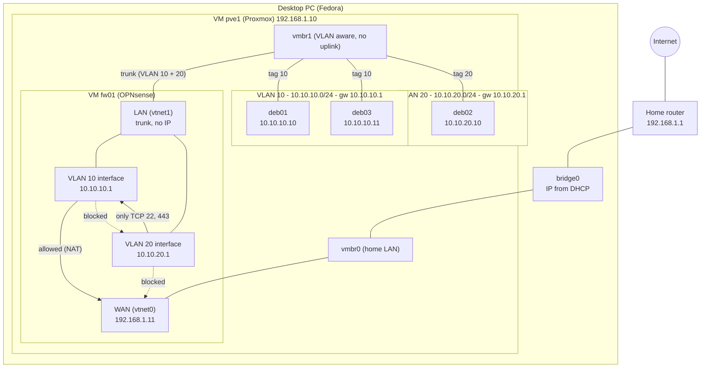
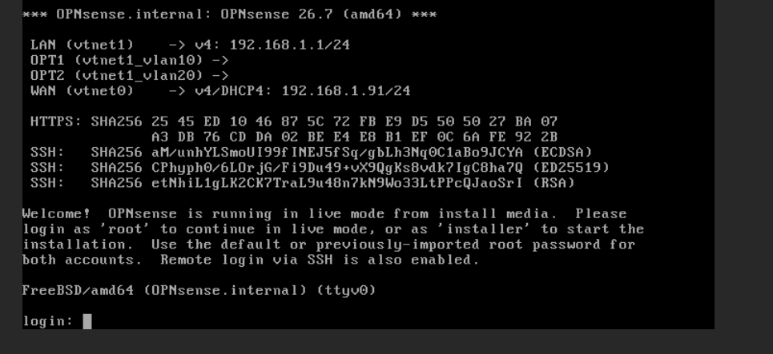
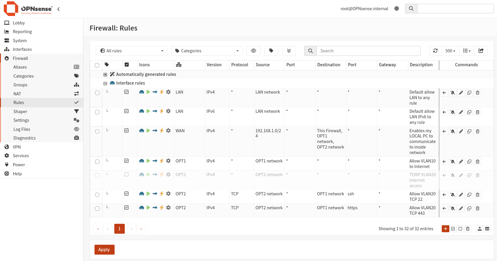

# 02b - Firewall and routing with OPNsense

## Goal

In the last step I split my lab into two VLANs, and they can't talk to each other. Now I add a firewall VM (OPNsense) between them. The goal is:

- VLAN 10 (servers) and VLAN 20 (clients) are connected through the firewall.
- The firewall decides what traffic is allowed, with clear rules.
- Servers can reach the Internet. Clients can't.
- Clients can reach the servers only on TCP ports 22 and 443.

This is the network I want to get:



Solid arrows are allowed traffic, dotted arrows are blocked traffic.

## 1. Setup

### The VM

`fw01` has two network cards in Proxmox:

- `net0` on `vmbr0`: this is the WAN, it reaches my home network.
- `net1` on `vmbr1` with **no VLAN tag**: this is the trunk. Because it has no tag, the card carries the frames of all VLANs, still tagged.

### Interfaces in OPNsense

OPNsense splits the trunk into one interface per VLAN:

| Name | Device | IP | Role |
|---|---|---|---|
| WAN | `vtnet0` | `192.168.1.11` | Connection to the home network |
| LAN | `vtnet1` | none | Trunk, carries all the VLANs |
| OPT1 | `vtnet1_vlan10` | `10.10.10.1/24` | Gateway of VLAN 10 |
| OPT2 | `vtnet1_vlan20` | `10.10.20.1/24` | Gateway of VLAN 20 |

The LAN interface has no IP on purpose. It is only a trunk: all traffic goes to `vtnet1_vlan10` or `vtnet1_vlan20`.



### Gateways and DHCP

The VMs must use the OPNsense interface of their VLAN as gateway. Without it they can't leave their own network (remember `Network is unreachable` from the last step).

**deb01** is a server, so it has a static IP and the gateway is set by hand:

```
auto ens18
iface ens18 inet static
    address 10.10.10.10/24
    gateway 10.10.10.1
```

The `gateway` line is the important one.

**deb02** is a client, so it uses DHCP:

```
auto ens18
iface ens18 inet dhcp
```

With DHCP the gateway is set automatically. For this to work, I enabled DHCP for the VLAN 20 interface in the OPNsense web interface:

`Services` > `Dnsmasq DNS & DHCP` > `General` > `Interface` > select `OPT2`

## 2. Internet access and NAT

The VMs have private IPs, so they can't go to the Internet directly. Their traffic has to leave with the IP of the firewall (`192.168.1.11`). This translation is called NAT, and the firewall keeps a table to know which answer goes to which VM.

I didn't have to create any NAT rule. OPNsense creates the outbound NAT rules for the WAN automatically.

The traffic is translated twice: first by OPNsense, then by my home router. It is a double NAT, and it is not a problem for this lab.

## 3. DNS with Unbound

OPNsense includes Unbound, a DNS resolver. The VMs ask it to translate domain names into IPs, so I have one place to manage DNS.

deb01 has a static IP, so I set the DNS server by hand in `/etc/resolv.conf`:

```
nameserver 10.10.10.1
```

deb02 gets its DNS server from DHCP.

## 4. Firewall rules

OPNsense checks the rules on the interface where the traffic **enters**. Traffic that matches no rule is blocked. So I only write the rules for what I want to allow.

| From | To | Allowed |
|---|---|---|
| VLAN 20 (clients) | VLAN 10 (servers) | TCP 22 and 443 only |
| VLAN 20 (clients) | Internet | No |
| VLAN 10 (servers) | Internet | Yes, with NAT |
| VLAN 10 (servers) | VLAN 20 (clients) | No |
| Home network `192.168.1.0/24` | Firewall, VLAN 10, VLAN 20 | Yes, only for the lab (see [Extra](#6-extra-reaching-the-opnsense-web-interface)) |



## 5. Tests

### Client to server (deb02 to deb01)

I use `nc` to check which ports are reachable. `-z` only checks the port without sending data, `-v` prints the result and `-w 3` waits at most 3 seconds.

Port 22 (allowed by the rule):

```bash
root@deb02:/home/user# nc -zv 10.10.10.10 22
Connection to 10.10.10.10 22 port [tcp/ssh] succeeded!
```

Port 443 (allowed by the rule), first with nothing listening on deb01:

```bash
root@deb02:/home/user# nc -zv -w 3 10.10.10.10 443
nc: connect to 10.10.10.10 port 443 (tcp) failed: Connection refused
```

`Connection refused` means the packet **got through** the firewall, and deb01 answered that no service listens on that port. The rule works.

Port 443 again, after something started listening on it:

```bash
root@deb02:/home/user# nc -zv -w 3 10.10.10.10 443
Connection to 10.10.10.10 443 port [tcp/https] succeeded!
```

Port 80 (not allowed by any rule):

```bash
root@deb02:/home/user# nc -zv -w 3 10.10.10.10 80
nc: connect to 10.10.10.10 port 80 (tcp) timed out: Operation now in progress
```

Here we get a `timed out`. The firewall drops the packet and doesn't answer, so deb02 just waits. This is what I expected from the rules.

The difference is useful for debugging:

- `Connection refused`: the packet arrived, the port is closed on the server.
- `timed out`: the packet didn't arrive, probably a firewall is dropping it.

### Internet access

From deb02 (client), VLAN 20 has no access to the Internet:

```bash
root@deb02:/home/user# ping -c 3 8.8.8.8
PING 8.8.8.8 (8.8.8.8) 56(84) bytes of data.

--- 8.8.8.8 ping statistics ---
3 packets transmitted, 0 received, 100% packet loss, time 2039ms
```

No answer, as expected.

From deb01 (server), VLAN 10 can reach the Internet:

```bash
root@deb01:/home/user# ping -c 3 8.8.8.8
PING 8.8.8.8 (8.8.8.8) 56(84) bytes of data.
64 bytes from 8.8.8.8: icmp_seq=1 ttl=115 time=17.6 ms
64 bytes from 8.8.8.8: icmp_seq=2 ttl=115 time=17.1 ms
64 bytes from 8.8.8.8: icmp_seq=3 ttl=115 time=17.4 ms

--- 8.8.8.8 ping statistics ---
3 packets transmitted, 3 received, 0% packet loss, time 2003ms
rtt min/avg/max/mdev = 17.149/17.398/17.623/0.194 ms
```

It answers, as expected. This also shows that the gateway and the NAT work.

## 6. Extra: reaching the OPNsense web interface

My setup is a bit special: OPNsense runs inside Proxmox, which runs inside a VM on my PC. The OPNsense WAN is on my home network, and by default a WAN blocks access to the web interface.

To open the web interface from my PC, I did this:

1. In the OPNsense shell (from the Proxmox console) I turned the firewall off with `pfctl -d`.
2. I opened the web interface from the browser of my PC.
3. I added a rule that allows traffic from `192.168.1.0/24` to the firewall, to OPT1 and to OPT2. This lets me use SSH to reach the machines.
4. I turned the firewall on again with `pfctl -e`.

While the firewall is off it filters nothing, so I kept that time as short as possible.

This is only for my lab. In a real network the WAN faces the Internet, and the web interface would be reachable only from the LAN or from a separate management interface, never from the WAN.

## What I learned

- A VM needs a gateway to leave its network, and the gateway can be a firewall.
- A trunk carries all the VLANs on one card, and OPNsense splits them into one interface per VLAN.
- A firewall blocks everything that has no allow rule.
- `Connection refused` and `timed out` mean different things: the first one is a closed port, the second one is usually a firewall.
