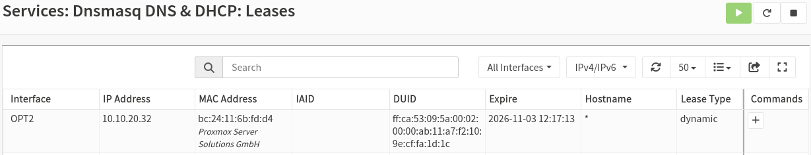

# 05 - Template and cloud-init

## Goal

Create a template to quickly provision VMs.

The template uses cloud-init, so user and network configuration are automated when I create new machines.

## 1. Why a cloud image

I create the template from a `.qcow2` file, not from an `.iso`.

An `.iso` is an installer: I have to boot it and go through the installation by hand. A `.qcow2` cloud image is already a fully installed machine. It is like a disk that I plug into a VM, and the OS is already there.

Why not install from the `.iso` and make a template from that machine?

- The installation is manual and slow, and every machine ends up a bit different.
- The installer asks for a user, a password, partitions and so on. These choices would be baked into the template.
- A normal install has no cloud-init, so every clone would have the same user and the same settings.
- The cloud image is small (~3 GB), generic, and already comes with cloud-init.

**cloud-init** is what separates the image (the same for everyone) from the configuration (different for each VM). At the first boot, the VM reads its configuration from outside and sets itself up: user, SSH key, hostname and network.

## 2. Downloading the image

From the Proxmox shell I download the `.qcow2`:

```bash
cd /var/lib/vz/template/
wget https://cloud.debian.org/images/cloud/trixie/latest/debian-13-genericcloud-amd64.qcow2
```

## 3. Creating an empty VM

I create a VM with no OS and no disk, because I will attach the disk later.

- **VM ID:** `9000`
- **OS:** `Do not use any media`
- **System:** I check **QEMU Agent**, so Proxmox can show me information about the machine.
- **Disks:** I remove the default `scsi0`, because I will attach the `.qcow2` later.
- **Network:** `vmbr1` with VLAN tag `20`. Recalling the last chapter, `vmbr1` is the internal bridge with the VLANs, attached to the OPNsense firewall. I want a template of "client devices", so I use the client VLAN (20).

## 4. Attaching the disk

From the Proxmox shell I import the image into the VM:

```bash
qm disk import 9000 /var/lib/vz/template/debian-13-genericcloud-amd64.qcow2 local-lvm
```

Now in the VM `Hardware` section I can see the disk, but it is `Unused Disk 0`: it still has to be connected to a controller.

`Hardware` > double click on the disk > Bus `SCSI` > `Add`

I also want the VM to boot from this disk:

`Options` > `Boot Order` > select `scsi0` and move it to the top.

The cloud image is small (~3 GB), so I resize the disk to make room for more data:

`Hardware` > select the disk > `Disk Action` > `Resize` > add `8 GB` (or as much as I want).

## 5. Adding the cloud-init drive

The VM could already boot, but first I add the drive that carries the cloud-init data.

`Hardware` > `Add` > `CloudInit Drive` > select the storage (`local-lvm` in my case) > `Add`

The drive is a small virtual CD-ROM. Proxmox writes my settings in it, and at boot cloud-init inside the VM reads them.

Now the VM has a `Cloud-Init` tab, where I set:

- **User:** `debian`
- **Password:** none. This way I can only access with SSH.
- **SSH public key:** the public key of my key pair (see below).
- **IP Config:** IPv4 `DHCP`. The clients in this network are meant to get their IP from OPNsense, and I will test if that works.

I save with **Regenerate Image**. Proxmox does not apply the changes until the cloud-init drive is regenerated, so I have to do it after every change.

### The SSH key pair

The idea: the public key stays on the template, and only computers with the private key can access it with SSH. No password travels on the network.

From my local machine:

```bash
ssh-keygen -t ed25519 -f ~/.ssh/homelab_ed25519 -C "homelab"
```

This creates two files:

- `homelab_ed25519`: the **private** key. It stays on my PC and never goes in the repo.
- `homelab_ed25519.pub`: the **public** key. This is the one I give to the VM.

I copy the content of the public key:

```bash
cat ~/.ssh/homelab_ed25519.pub
```

and paste it into the `SSH public key` field of cloud-init.

## 6. First boot and finding the IP

I start the machine and I get a login prompt for `debian`, the user I set in cloud-init.

But I didn't set a password! So how can I access? With SSH. But what is the IP of the machine?

Normally the QEMU agent gives the IP in `Summary`, but this image does not come with it, so I have to access the machine and install it. But then how do I find the IP that DHCP gave?

I check OPNsense: `Services` > `DHCP` > `Leases`. I see that the DHCP service gave an IP to a machine, and the MAC address matches the NIC of my VM.



From the image the IP is `10.10.20.32`. The DHCP is working: in the previous chapter I set OPNsense to give addresses in the range `10.10.20.10` - `10.10.20.200`.

### First SSH connection

```bash
ssh -i ~/.ssh/homelab_ed25519 debian@10.10.20.32
```

The first time, SSH asks if I trust the host, because it has never seen this server before (it shows the fingerprint of the host key). This is called TOFU (Trust On First Use). In my lab I know that the IP is my VM, so I answer `yes`. SSH saves the fingerprint in `~/.ssh/known_hosts` and warns me if it changes in the future.

I can log in only with the private key `homelab_ed25519`.

## 7. Installing the QEMU guest agent

I don't want to open OPNsense every time I need an IP, so I install the **QEMU guest agent**. It is a small service inside the VM that lets Proxmox talk to it: it shows the IP in `Summary`, allows a clean shutdown, and freezes the filesystem during backups.

First, in `Options` I check that `QEMU Guest Agent` is `Enabled`.

To install the package the VM needs Internet. In my case I had to enter OPNsense and enable a temporary firewall rule that lets the clients reach the Internet. I already had this rule from the previous chapter, I only had to enable it. After the installation I disabled it again.

```bash
sudo apt update
sudo apt install -y qemu-guest-agent
sudo systemctl start qemu-guest-agent
systemctl status qemu-guest-agent
```

I don't need `systemctl enable`: on Debian the service is started by udev when the virtio serial port appears.

From the Proxmox shell I can test it:

```bash
qm agent 9000 ping
```

No output and no error means it works. Now the IP is visible in `Proxmox` > `Summary`. All good, I can make this into a template.

## 8. Cleaning the machine

Before the template, I clean the logs and everything I touched, so they don't get copied to the clones.

```bash
sudo apt clean
sudo cloud-init clean --logs --seed
sudo truncate -s 0 /etc/machine-id
sudo rm -f /etc/ssh/ssh_host_*
history -c && rm -f ~/.bash_history
sudo poweroff
```

- `sudo apt clean`: empties the package cache, so the template is lighter.
- `sudo cloud-init clean --logs --seed`: cleans the cloud-init state created when I booted the machine. This way each clone is seen as a **new instance** and runs cloud-init again.
- `sudo truncate -s 0 /etc/machine-id`: it is a unique ID that many services use. I set the file to 0 bytes (I don't delete it) so a new one is generated at the next boot.
- `sudo rm -f /etc/ssh/ssh_host_*`: removes the SSH host keys. They are generated again at the first boot, so each clone has its own keys.
- `history -c && rm -f ~/.bash_history`: cleans the command history.
- `sudo poweroff`: I do not reboot after the cleaning, otherwise everything is generated again and I have to repeat the cleanup.

## 9. Template and clones

After the power off:

`Right click on the VM` > `Convert to template`

I rename the template to something clear, like `debian13-cloudinit-tpl`. The name does not influence the clones, but it helps me recognize it, and I will need it for Terraform.

Then:

`Right click on the template` > `Clone`

There are different modes. The most important to know are:

- **Full clone:** a full copy of the disk. It is an independent copy that can be migrated and moved with no problems.
- **Linked clone:** it points to the disk of the template and only grows when there are differences with it. It is fast and small, but I can't delete the template while the clones exist.

I also give a name to each clone. cloud-init uses this name as the **hostname** of the machine.

## 10. Results

I created 3 clones, `clone-01`, `clone-02` and `clone-03`, and I logged into all of them with the private key.

- Each clone has its own hostname, the same as its VM name in Proxmox.
- Each clone has a different MAC, so a different IP from the DHCP.
- I can enter only with the key `homelab_ed25519`, because the public key is in the template.

## 11. What I learned

- cloud-init separates the image (the same for everyone) from the configuration (different for each VM).
- It runs only at the first boot of a new instance. That is why I run `cloud-init clean` before the template.
- The public key is on the server, the private key stays with me. There is no password login, so no brute force on the password.
- **Regenerate Image** is needed because the cloud-init drive is a generated file, not a value read "live".
- Template + cloud-init is the local version of AMI + user data in AWS.
